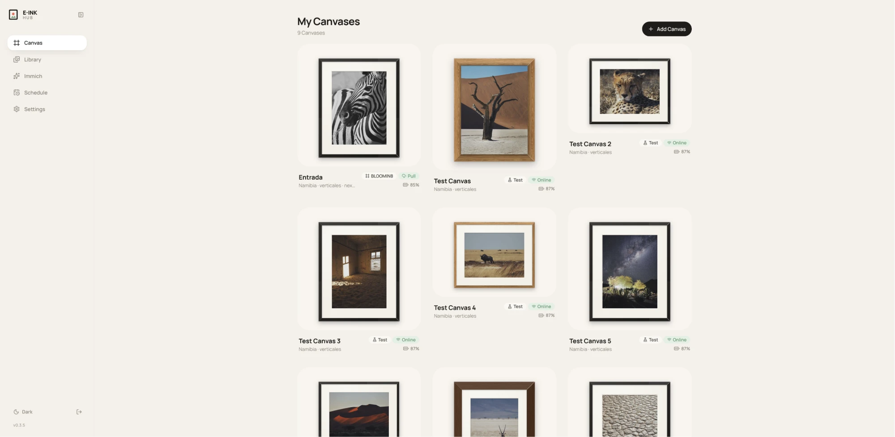
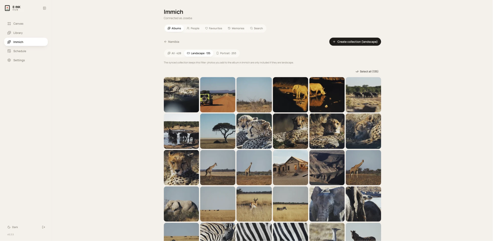
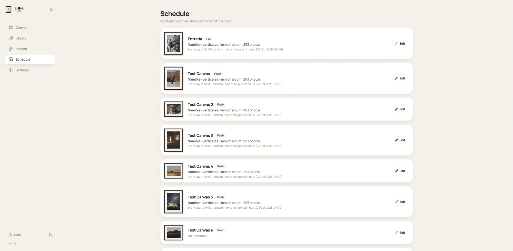
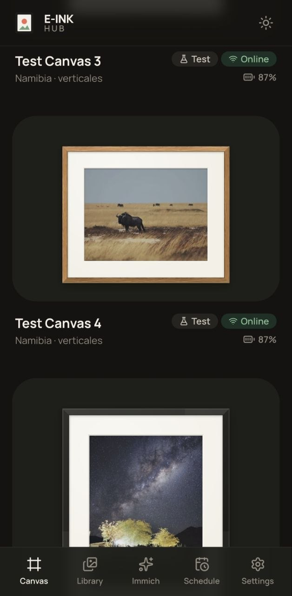

#  E-Ink Hub

Self-hosted control center for e-ink photo frames, with **Immich** integration. A single Docker container (Node + SQLite) with a mobile-friendly web UI.

📖 **Documentation: https://yayitazale.github.io/eink-hub/**

| Frame | Integration | |
| --- | --- | --- |
| [BLOOMIN8 E-Ink Canvas](https://yayitazale.github.io/eink-hub/devices/bloomin8) | 🏠 Local | ✅ |
| [SwitchBot AI Art Frame](https://yayitazale.github.io/eink-hub/devices/switchbot) | ☁️ Cloud | ✅ ⚠️ not tested |
| [TRMNL firmware](https://yayitazale.github.io/eink-hub/devices/trmnl) (TRMNL, Waveshare PhotoPainter, reTerminal…) | 🏠 Local | ✅ ⚠️ not tested |
| [Your own ESP32 / Raspberry Pi frame](https://yayitazale.github.io/eink-hub/diy/) | 🏠 Local | ✅ ⚠️ not tested |

- Exact previews with smart crop, manual crop, border or blurred background
- Collections from uploads or Immich (albums, people, favourites, smart search, "on this day")
- Schedules with active hours; battery-friendly pull mode; Bluetooth wake for BLOOMIN8
- An open protocol for DIY frames, with ESP32 and Raspberry Pi [examples](examples)



<p>
  
  
  
</p>

## Quick start

```bash
cp .env.example .env   # set LOCAL_URL to this machine's LAN address
docker compose up -d
```

Open `http://<host>:8080`, choose an admin password and **Add Canvas**. No hardware? Add a *Simulated Canvas*.
See [Getting started](https://yayitazale.github.io/eink-hub/guide/getting-started) for the rest.

On **Unraid**, install *eink-hub* from Community Applications, with Tailscale support built in: see [Unraid](https://yayitazale.github.io/eink-hub/guide/unraid).

## Development

```bash
npm install
npm run dev:server   # API on :8080
npm run dev:web      # UI on :5173
npm test
```

The website lives in [`docs-site/`](docs-site) (VitePress). Contributions are welcome: see [CONTRIBUTING.md](CONTRIBUTING.md) and the [development docs](https://yayitazale.github.io/eink-hub/development/).

> 🤖 This project has been developed together with [Claude](https://claude.ai).

## License

[MIT](LICENSE) © 2026 [Joseba Egia](https://josebaegia.me/). Third-party components are listed in [THIRD-PARTY-NOTICES.md](THIRD-PARTY-NOTICES.md). Not affiliated with BLOOMIN8, SwitchBot or TRMNL.
